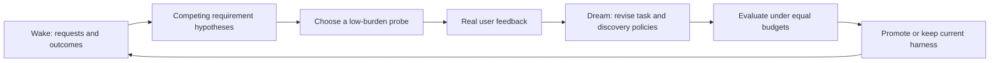

# activeRSI

Active requirement discovery and recursive self-improvement for personal agents.

A personal agent should discover what would help its user next. activeRSI gives it a wake–sleep loop: learn from real interactions, dream about unmet needs, test changes to its behavior, and improve the way it discovers requirements in the next cycle.

Consider a user who repeatedly rewrites a daily plan on their phone. They may need a compact layout, clearer priorities, or fewer commitments. The agent forms competing hypotheses and chooses a useful question or reversible trial. During sleep it revisits those outcomes, develops a better planning workflow, and changes how it will recognize similar needs next time.

## The loop



The task policy controls how the agent works. The discovery policy controls which questions it asks and how it searches for useful improvements. Both travel in the versioned harness, so an accepted discovery-policy change affects the next cycle. A dream produces hypotheses and candidate behavior; waking interactions provide the user feedback.

## Quick start

Python 3.10+ on Linux or macOS. The runtime uses the Python standard library.

```bash
git clone https://github.com/tongmd/activeRSI.git
cd activeRSI
python3 -m pip install -e .
python3 -m unittest discover -s tests -v
python3 examples/demo.py  # complete offline cycle, including evaluation and rollback

python3 -m activersi --workspace .workspace init
python3 -m activersi --workspace .workspace observe \
  --kind correction --text "I keep rewriting this plan before I can use it on my phone."
python3 -m activersi --workspace .workspace dream --demo
python3 -m activersi --workspace .workspace wake
python3 -m activersi --workspace .workspace status
```

`--demo` runs a deterministic synthetic example without a model or network connection. It demonstrates the lifecycle; its generated needs and feedback remain labeled synthetic.

Use the hypothesis ID returned by `wake` to record a response:

```bash
python3 -m activersi --workspace .workspace feedback \
  --hypothesis HYPOTHESIS_ID --decision accept \
  --text "Keep all tasks; make the plan easier to scan."
```

`wake` dequeues the selected probes and marks them as offered; it does not send them. Use `status` for read-only inspection.

For real interactions, the host records the user's actual response. `answer` records a reply without asserting confirmation; `reject` rejects the hypothesis. Feedback does not automatically activate a candidate.

## Connect a personal agent

Load the workspace's `harness/AGENT.md` into your host agent's instructions. Feed authorized requests, corrections, and outcomes through `observe`. Call `wake` when a useful question can fit the interaction, and return actual feedback. Run `dream` at an idle point or through your existing scheduler.

A model adapter is a command receiving one JSON request on stdin and returning one JSON proposal on stdout. Configure its argument list at initialization:

```bash
python3 -m activersi --workspace /path/to/workspace init \
  --adapter-command '["python3", "/absolute/path/to/adapter.py"]' \
  --timeout 90
python3 -m activersi --workspace /path/to/workspace dream
```

A ready-to-use chat-completions adapter is included:

```bash
export ACTIVERSI_API_URL=http://localhost:8000/v1/chat/completions
export ACTIVERSI_MODEL=your-served-model
# Set ACTIVERSI_API_KEY in the environment if your provider requires one.
python3 -m activersi --workspace .workspace-model init \
  --adapter-command "[\"python3\", \"$PWD/examples/openai_adapter.py\"]"
```

The endpoint must support chat completions and JSON-object responses. The example uses your configured service; the offline demo never calls it. Add observations before running `dream` in this new workspace.

The request contains current task and discovery policies, observations, previous hypotheses, actual feedback, and the response contract. The response supplies competing hypotheses, observation references, probes with estimated information gain and interruption cost, a candidate harness, and a candidate discovery policy. Probe values are estimates used for ranking, not measured user satisfaction.

Adapter commands run with your local permissions. Configure a trusted adapter and keep API keys in its environment. The runtime invokes one bounded proposal call per dream and does not execute generated code or send messages. Workspaces are local and private by default; model adapters receive their scoped observations. Keep workspaces outside public source control.

## Evaluate, promote, roll back

Keep evaluation cases separate from the proposal input. An evaluator receives a baseline or candidate harness, a case, and a fixed budget. It must actually run the task and return its measured outcome. The runner executes both versions, validates responses, and writes a hash-bound report.

```bash
python3 scripts/evaluate.py --root .workspace \
  --candidate .workspace/cycles/DREAM_ID/candidate.md \
  --cases /path/to/cases.json \
  --command '["python3", "/absolute/path/to/evaluator.py"]' \
  --output /path/to/results.json --risk low

python3 scripts/active_rsi.py --root .workspace gate \
  --candidate .workspace/cycles/DREAM_ID/candidate.md --report /path/to/results.json
python3 scripts/active_rsi.py --root .workspace promote \
  --candidate .workspace/cycles/DREAM_ID/candidate.md --report /path/to/results.json
python3 scripts/active_rsi.py --root .workspace rollback --revision REVISION_ID
```

`--risk low` is appropriate for scoped, reversible behavior changes such as the tutorial. Other changes default to high risk. The runner also rejects an increase in reported questions or cost for any case; cost units are defined by your evaluator. Each task gets the same timeout, question limit, and cost limit.

The gate requires at least three distinct held-out cases, an improvement, no task regressions, and no reported safety violations. A promoted harness is loaded in subsequent cycles. Revisions support rollback. High-risk adaptations require actual user authorization before passing `--user-approved`.

The evaluator defines what success means. Use independent task checks, separate proposal and evaluation processes, and measure task success alongside repeated corrections, interruptions, latency, and cost. The deterministic example checks plumbing only. Testing whether the discovery process improves across new tasks and users remains an empirical research question.

## Project structure

| Path | Purpose |
|---|---|
| `activersi/` | Persistent wake/sleep runtime and CLI |
| `examples/` | Adapter and runnable synthetic examples |
| `scripts/evaluate.py` | Execute baseline and candidate evaluations |
| `scripts/active_rsi.py` | Hash-bound promotion, revisions, rollback |
| `harness/AGENT.md` | Readable starting task and discovery instructions |
| `SKILL.md` | Integration instructions for agent hosts |
| `tests/` | Runtime, evaluator, and revision tests |

See [evaluation protocol](references/protocol.md) for report fields. Contributions should include a reproducible scenario, behavioral tests, and a clear account of which loop component changes. Run the test suite before opening a pull request.

## Related projects

The [Awesome RSI](https://github.com/lobehub/awesome-rsi) catalog connects several useful implementation patterns:

- [autoresearch](https://github.com/karpathy/autoresearch): bounded experiments with a fixed evaluation setup.
- [HyperAgents](https://github.com/facebookresearch/HyperAgents): a task agent and an improvable meta-agent.
- [Hermes Agent](https://github.com/NousResearch/hermes-agent): a personal-agent runtime with skills and scheduled work.

activeRSI applies these ideas to discovering user requirements and improving the discovery process itself.

MIT License · [Tong Zhang](https://stonezhang.com/)
